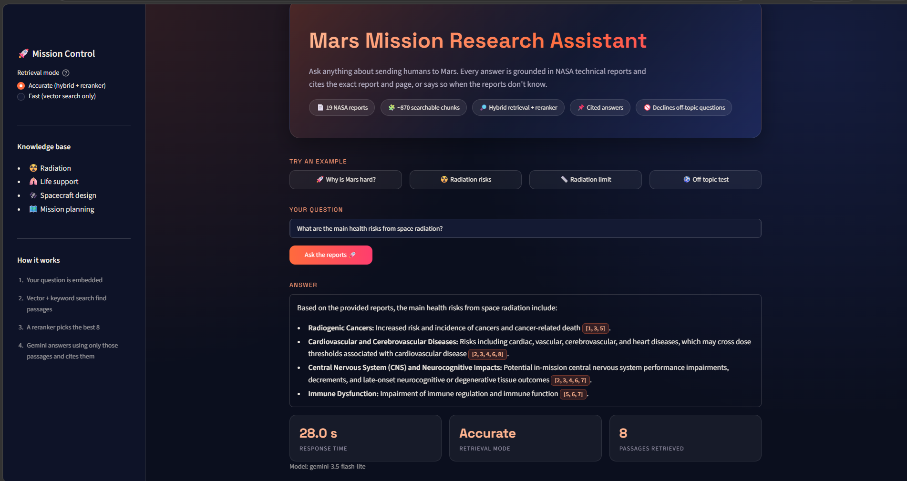
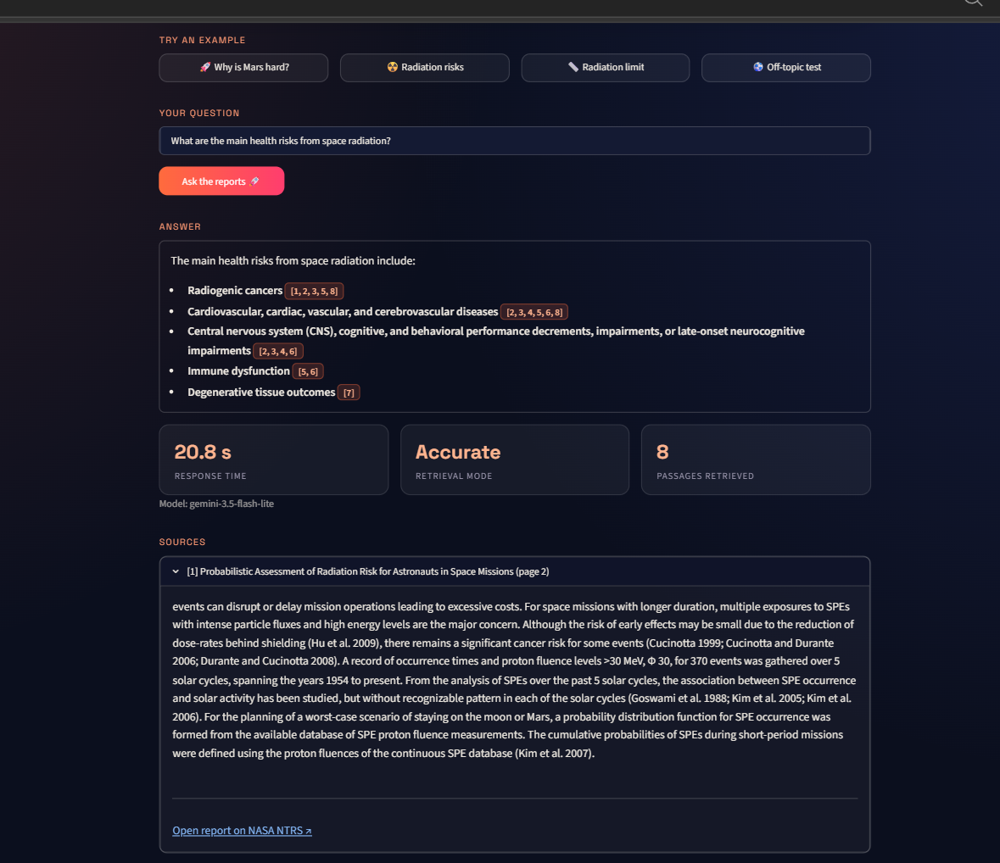
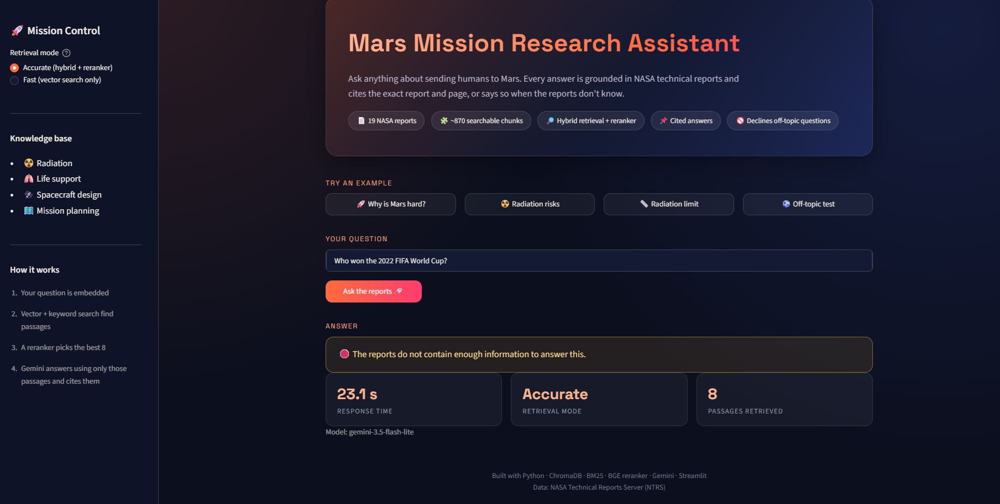

# 🚀 Mars Mission Research Assistant


A Retrieval-Augmented Generation (RAG) assistant that answers questions about human missions to Mars using **NASA technical reports**. Every answer cites the exact report and page, and the system declines questions the reports cannot answer.





## What it does


- Searches 19 NASA NTRS reports (radiation, life support, spacecraft design, mission planning)

- Answers only from the retrieved passages, with numbered citations mapped to report title, page and NASA URL

- Declines off-topic questions instead of guessing

- Offers two retrieval modes: **Fast** (vector search) and **Accurate** (hybrid search + reranker)


## Architecture


**Ingestion (run once)**

```

NASA NTRS API -> PDFs -> text per page (PyMuPDF) -> 200-word overlapping chunks

-> embeddings (BAAI/bge-small-en-v1.5) -> ChromaDB + BM25 index

```


**Query (every question)**

```

Question -> embed -> vector search (top 20) + BM25 keyword search (top 20)

-> Reciprocal Rank Fusion -> cross-encoder reranker (bge-reranker-base) -> top 8 chunks

-> Gemini (answer only from sources, cite [n]) -> citation check in code -> answer + sources

```


## Tech stack


Python · PyMuPDF · sentence-transformers · ChromaDB · rank_bm25 · BGE reranker · Google Gemini · Flask · Streamlit


## Data


19 public reports from the [NASA Technical Reports Server](https://ntrs.nasa.gov), including *Human Exploration of Mars Design Reference Architecture 5.0*, *Moon 2 Mars Space Radiation Protection*, and the *Mars Portable Life Support System* studies. IDs and titles are in `data/reports_metadata.json`. One report with no extractable text was dropped.


## Results


Evaluated on 25 questions (18 answerable, 7 off-topic). 12 were hand-written and 13 were generated by an LLM from report passages and manually filtered. One ambiguous generated question was removed before final scoring.


| Metric | Baseline (vector only) | Hybrid + reranker |
|---|---|---|
| Decline accuracy (off-topic) | 7/7 | 7/7 |
| False declines (answerable) | 1/18 | 0/18 |
| Answers with citations | 17/17 | 18/18 |
| Average latency | 2.15 s | 14.93 s |


**Takeaway:** hybrid retrieval and reranking fixed one retrieval miss (Q1) with no new failures, at roughly 7x the latency. The test set is small, so treat these as a baseline, not proof.


## Examples


**Worked.** "What are the main health risks from space radiation?" returned cancer, cardiovascular, CNS and immune risks, citing three different reports.





**Correct decline.** "Who won the 2022 FIFA World Cup?" returned "The reports do not contain enough information to answer this."





**Failed, then fixed.** "How long does a one-way trip to Mars take in the Design Reference Architecture 5.0?" was falsely declined by vector-only search. It retrieved the report's intro pages, not the pages with the trip duration. Hybrid retrieval and reranking fixed it.


More in `evaluation/baseline_examples.md`.


## Limitations


- Reranking runs on CPU, so answers take about 10 to 30 s in accurate mode.

- Declining relies on the prompt, and retrieval still runs first. A score threshold didn't work because related off-topic questions scored high.

- Citations are valid but sometimes broad, and the model may simplify a range (e.g. 180 to 300 days as "about 180").

- Old scanned reports contain OCR errors, and near-duplicate reports can repeat the same page.

- Small test set, and some questions are LLM-generated.

- Evaluation uses simple counting metrics. RAGAS (context precision, recall, faithfulness) is planned next.


## Run it


```bash

git clone https://github.com/chaitrapatil2/mars-mission-rag-assistant.git

cd mars-mission-rag-assistant

python -m venv venv

venv\Scripts\activate

pip install -r requirements.txt

```

Create a `.env` file with `GEMINI_API_KEY=your_key`, then rebuild the data (the PDFs and vector database are not stored in the repo):

```bash

python src/download_reports.py

python src/extract_text.py

python src/chunk_text.py

python src/build_index.py

```

Run it:

```bash

streamlit run src/app.py      # web interface

python src/ask.py             # terminal

python src/api.py             # Flask API (POST /ask)

```

Evaluation:

```bash

python src/run_eval.py

python src/run_eval_v2.py

python src/score_basic.py evaluation/results_v2.json

```


## Next steps


RAGAS metrics, a larger test set, a faster reranker, OCR for scanned reports, and a Java/Spring Boot version.

